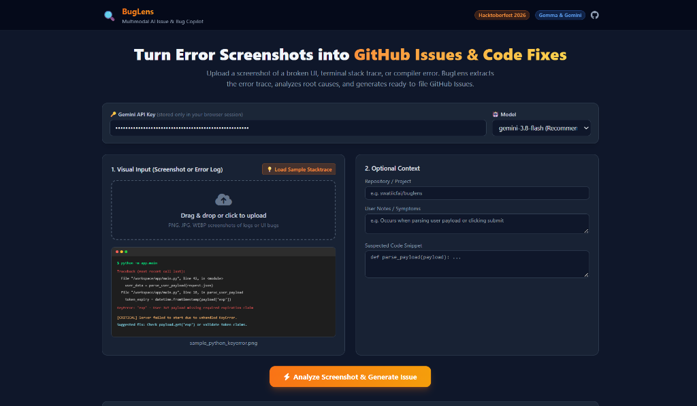
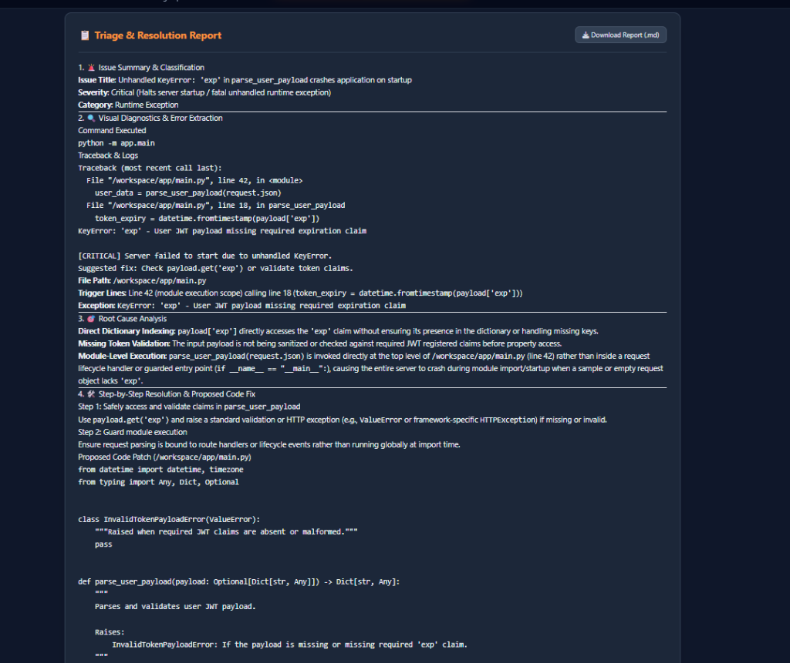
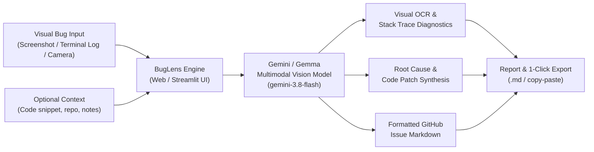

# 🔍 BugLens — Multimodal AI Issue & Bug Copilot

[](https://swatiicfai.github.io/buglens/)
[](https://github.com/swatiicfai/buglens)
[](LICENSE)

> **Turn screenshots of broken UIs, terminal stack traces, and console logs into instant root-cause diagnoses, code patches, and ready-to-file GitHub Issues.**

Built and submitted for **Hacktoberfest Hack Day Bengaluru 2026 (BMSCE IEEE Computer Society x Major League Hacking x NTT)**.

---

### 🌐 Live Deployment
👉 **Try it now in your browser:** **[https://swatiicfai.github.io/buglens/](https://swatiicfai.github.io/buglens/)**  
*(Zero setup or installation required — runs directly in your browser powered by Google Gemini/Gemma multimodal vision!)*

---

## 📸 Screenshots & Live Demo

### 1. Visual Bug & Stack Trace Ingestion Dashboard


### 2. Automated Root-Cause Diagnosis, Code Patch & Issue Generation


---

## 🏆 Hackathon Submission Details

* **Event:** Hacktoberfest Hack Day Bengaluru 2026
* **Host:** BMSCE IEEE Computer Society in partnership with Major League Hacking (MLH) and NTT
* **Submission Status:** Officially Submitted & Locked In
* **Live Demo URL:** [https://swatiicfai.github.io/buglens/](https://swatiicfai.github.io/buglens/)
* **Repository:** [https://github.com/swatiicfai/buglens](https://github.com/swatiicfai/buglens)

### Entered Prize Tracks

| Track | Sponsor | How BugLens Fits |
| :--- | :--- | :--- |
| **Best Use of Gemma 4** | **Google / DeepMind** | BugLens leverages multimodal intelligence via the Gemini API to visually inspect screenshots of terminal stack traces, console logs, and UI glitches. It extracts error traces directly from image pixels, analyzes root causes, and synthesizes code fixes and formatted GitHub issues. |
| **Best Open-Source AI Project** | **DigitalOcean** | BugLens is a 100% open-source developer tool licensed under the MIT License, built specifically to empower the open-source community by helping contributors and maintainers triage visual bugs, errors, and UI regressions automatically. |

### AI Coding Tools Transparency
* **AI Coding Harness:** Antigravity
* **Model Used by Agent:** Gemini 3.8 Flash

---

## 📌 Problem Statement

During hackathons and open-source contribution sprints (like Hacktoberfest):
1. **Contributors struggle to report bugs accurately**: Users and testers take a screenshot of a broken UI or crash dump, but struggle to articulate reproduction steps, tech stack details, or root causes.
2. **Maintainers waste hours triaging vague issues**: Maintainers receive tickets with just an image saying *"this broke"* without logs or system context.
3. **Debugging across modalities is slow**: Developers constantly switch context between image screenshots, terminal logs, and code editors.

---

## 💡 Solution: BugLens

**BugLens** is a multimodal AI copilot that bridges visual bug evidence directly with code-level resolutions:
- 📷 **Multimodal Vision Ingestion**: Accepts screenshots of terminal stack traces, compiler errors, React hydration errors, or visual UI regressions.
- 🔍 **OCR & Contextual Diagnostics**: Accurately extracts file names, line numbers, variable states, and error types directly from raw pixels.
- 🎯 **Automated Root-Cause Analysis**: Diagnoses why the failure occurred within milliseconds.
- 🛠️ **Production-Ready Code Patch**: Synthesizes the exact code fix with comments.
- 📋 **1-Click GitHub Issue Template**: Formats a complete, production-grade GitHub Issue Markdown report ready to submit or download.

---

## 🏗️ Architecture & Workflow



---

## 🚀 Running the Project

### Option A: Use the Live Web App (Instant)
Simply open **[https://swatiicfai.github.io/buglens/](https://swatiicfai.github.io/buglens/)**, paste your Gemini API Key, and upload or test with the built-in sample!

### Option B: Run Locally with Streamlit

#### 1. Clone & Enter Directory
```bash
git clone https://github.com/swatiicfai/buglens.git
cd buglens
```

#### 2. Install Dependencies
```bash
pip install -r requirements.txt
```

#### 3. Configure API Key
```bash
cp .env.example .env
# Add your GEMINI_API_KEY inside .env
```
*(Alternatively, you can paste your key directly into the sidebar at runtime.)*

#### 4. Run the Streamlit Dashboard
```bash
python -m streamlit run app.py
```
The dashboard will open automatically in your browser at `http://localhost:8501`.

---

## 🎯 Built-in Sample for Instant Testing

Don't have a broken screenshot on hand? BugLens comes with a pre-rendered terminal stack trace sample:
1. In the app, click **"💡 Load Sample Stacktrace"** (or the Sample tab in Streamlit).
2. Click **"🚀 Analyze Screenshot & Generate Issue"**.
3. Watch BugLens identify the unhandled `KeyError: 'exp'` in JWT parsing and generate the fix + GitHub issue in seconds!

---

## 📜 License

Distributed under the [MIT License](LICENSE).
