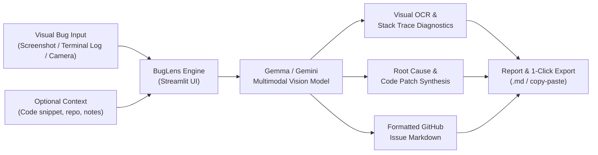

# 🔍 BugLens — Multimodal AI Issue & Bug Copilot

[](https://hacktoberfest.com/)
[](LICENSE)
[](https://www.python.org/)
[](https://streamlit.io/)
[](https://ai.google.dev/)

> **Turn screenshots of broken UIs, terminal stack traces, and console logs into instant root-cause diagnoses, code patches, and copy-pasteable GitHub Issues.**

Built for **Hacktoberfest Hack Day Bengaluru 2026 (BMSCE IEEE Computer Society x MLH)**.

---

## 📌 Problem Statement

During hackathons and open-source contribution sprints (like Hacktoberfest):
1. **Contributors struggle to report bugs accurately**: Users and testers take a screenshot of a broken UI or crash dump, but struggle to articulate reproduction steps, tech stack details, or root causes.
2. **Maintainers waste hours triaging vague issues**: Maintainers receive tickets with just an image saying *"this broke"* without logs or context.
3. **Debugging across modalities is slow**: Developers constantly switch context between image screenshots, terminal logs, and code editors.

---

## 💡 Solution: BugLens

**BugLens** is a multimodal AI copilot that bridges visual bug evidence with code-level resolutions:
- 📷 **Multimodal Vision Ingestion**: Accepts screenshots of terminal stack traces, compiler errors, React hydration errors, or visual UI regressions.
- 🔍 **OCR & Contextual Diagnostics**: Accurately extracts file names, line numbers, variable states, and error types directly from pixel data.
- 🎯 **Automated Root-Cause Analysis**: Diagnoses why the failure occurred within milliseconds.
- 🛠️ **Production-Ready Code Patch**: Synthesizes the exact code fix with comments.
- 📋 **1-Click GitHub Issue Template**: Formats a complete, production-grade GitHub Issue Markdown report ready to submit or download.

---

## 🏗️ Architecture & Workflow



---

## 🚀 Quickstart Guide

### 1. Clone & Enter Directory
```bash
git clone https://github.com/your-username/buglens.git
cd buglens
```

### 2. Install Dependencies
```bash
pip install -r requirements.txt
```

### 3. Configure API Key
Create a `.env` file or export your Gemini API key:
```bash
cp .env.example .env
# Add your GEMINI_API_KEY inside .env
```
*(Alternatively, you can paste your key directly into the app sidebar at runtime.)*

### 4. Run the Application
```bash
python -m streamlit run app.py
```
The app will automatically open in your browser at `http://localhost:8501`.

---

## 🎯 Built-in Sample for Instant Testing

Don't have a screenshot on hand? BugLens comes with a pre-rendered terminal stack trace sample:
1. In the app, click the **"💡 Sample Image"** tab.
2. Click **"Use Sample Python KeyError Stacktrace"**.
3. Hit **"🚀 Analyze Screenshot & Generate Issue"**.
4. Watch BugLens identify the unhandled `KeyError: 'exp'` in JWT parsing and generate the fix + GitHub issue in seconds!

---

## 🏆 Hackathon Tracks & Alignment

### 1. Best Use of Gemma / Multimodal (Google / DeepMind)
- Utilizes multimodal intelligence (vision + text) to inspect complex real-world visual artifacts (terminal logs, broken UI layouts).
- Delivers structured reasoning: visual extraction $\rightarrow$ semantic cause $\rightarrow$ code generation.

### 2. Best Open Source AI Project (DigitalOcean)
- 100% open-source under the **MIT License**.
- Directly designed to accelerate the open-source community by streamlining issue reporting and bug triage for developers and maintainers.

---

## 📜 License

Distributed under the [MIT License](LICENSE).
